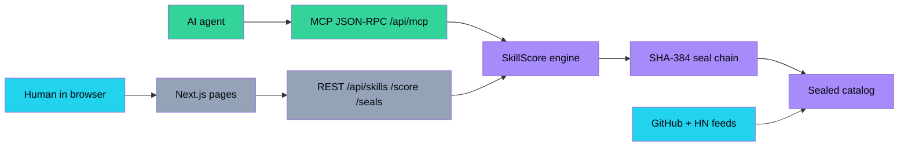
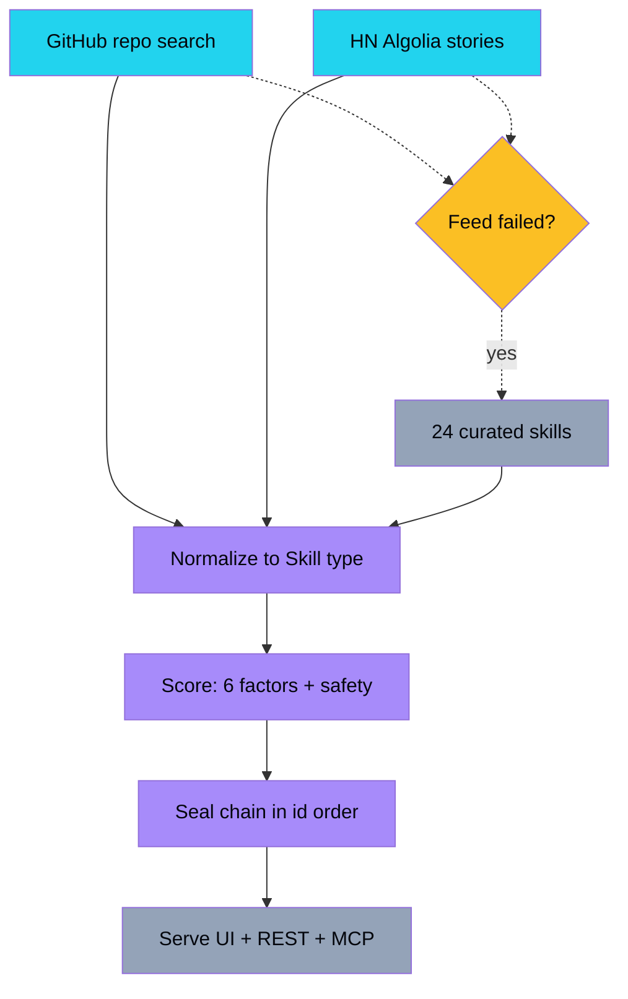
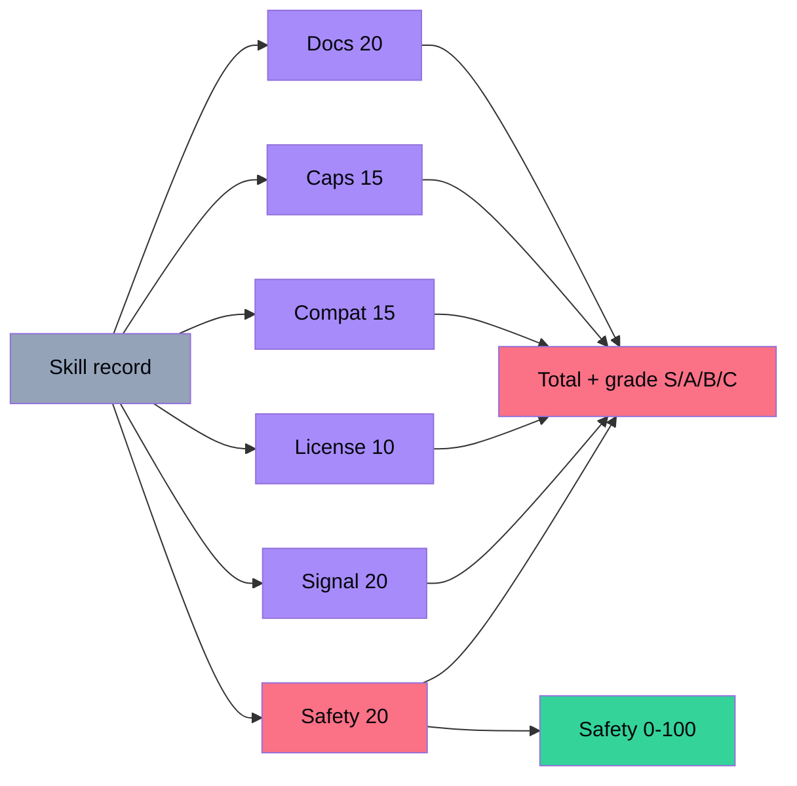
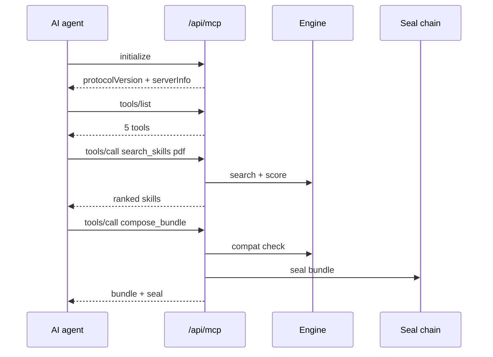
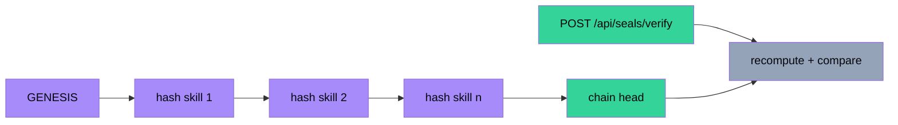
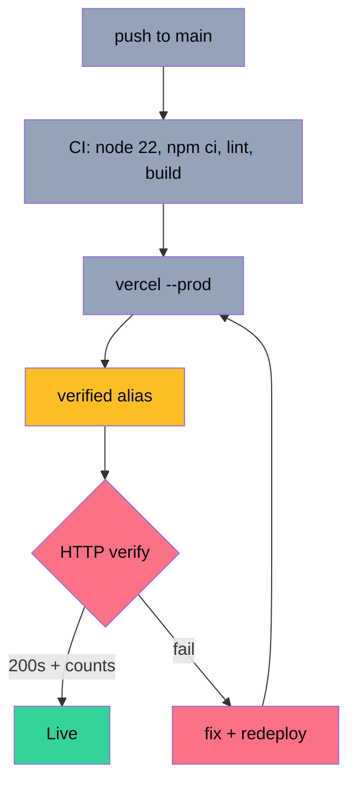
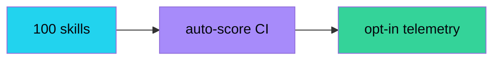
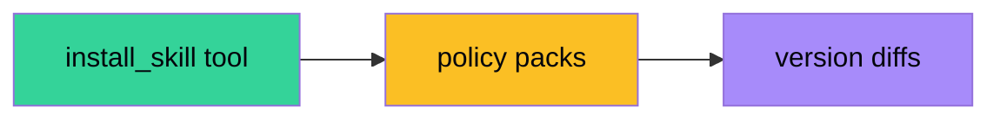
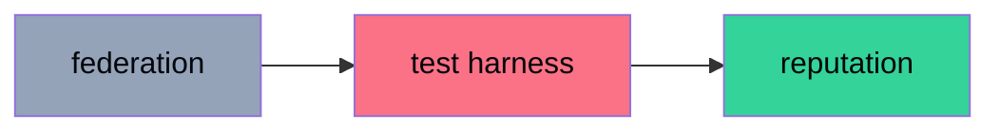

<div align="center">

# ⚒️ SkillForge

**The free open registry for reusable AI agent skills — search, safety-score, compose, install.**

[](https://skillforge-aniruddha-adaks-projects.vercel.app)
[](LICENSE)
[](https://nextjs.org)
[](https://skillforge-aniruddha-adaks-projects.vercel.app/api/mcp)
[](https://skillforge-aniruddha-adaks-projects.vercel.app/api/skills)

[Live App](https://skillforge-aniruddha-adaks-projects.vercel.app) · [API](https://skillforge-aniruddha-adaks-projects.vercel.app/api/skills) · [MCP](https://skillforge-aniruddha-adaks-projects.vercel.app/api/mcp) · [Issues](https://github.com/aniruddhaadak80/skillforge/issues)

</div>

> **The pick:** reusable agent skills are where agentic AI is bottlenecking — every OpenClaw / Claude Code / Cursor user rewrites the same prompts, while MCP made agents tool-hungry and SKILL.md made knowledge portable. SkillForge is the free, keyless, offline-first registry that scores, seals, and serves skills to humans *and* agents. The 10-second wow: type `pdf`, watch a safety-scored skill card appear with its seal, copy one curl line — or let your agent do it over MCP.

---

## ✨ Features

- 🔍 **Advanced search** — full-text relevance + category, platform, safety-floor, and ranking filters
- 🧮 **SkillScore engine** — deterministic, keyless, explainable: 6 itemized factors, S/A/B/C grades, separate 0–100 safety score
- 🤖 **Agent-native MCP** — JSON-RPC `initialize` / `tools/list` / `tools/call` with 5 tools + live in-page console
- 🔗 **Hash-chained seals** — `SHA-384(prevSeal ‖ canonicalJson)` on every record, replay-verifiable
- 📦 **Bundle composer** — compatibility checks, combined score, install script, MCP bundle export
- 📄 **One-command install** — raw `SKILL.md` per skill for OpenClaw, Claude Code, Cursor, any MCP agent
- 📡 **Live feeds, sealed fallback** — GitHub + Hacker News hourly; 24 curated skills keep everything alive offline
- 🗺️ **Learn the ladder** — docs + safety briefing from prompts to AGI, recursive self-improvement, and ASI
- 🕸️ **Interactive skill network** — canvas hero visual (deliberately *not* a globe: the network *is* the domain)

---

## 🏗️ System architecture



## 📡 Data pipeline



## 🧮 Engine flow



## 🤖 Agent (MCP) sequence



## 🔗 Integrity / seal chain



## 🚀 Deployment pipeline



## 🧭 User journey

```mermaid
flowchart LR
    LAND[Land on hero] --> SEARCH[Search: pdf]
    SEARCH --> OPEN[Open skill page]
    OPEN --> SCORE[Read score + seal]
    SCORE --> INSTALL[1-line install]
    INSTALL --> BUNDLE[Compose bundle]
    BUNDLE --> VERIFY[Verify seals]
    classDef live fill:#22d3ee,color:#04060c;
    classDef ai fill:#a78bfa,color:#04060c;
    classDef agent fill:#34d399,color:#04060c;
    class LAND,SEARCH live;
    class OPEN,SCORE ai;
    class INSTALL,BUNDLE,VERIFY agent;
```



---

## 🚀 Quickstart

Zero env vars. No keys. Free forever.

```bash
git clone https://github.com/aniruddhaadak80/skillforge.git
cd skillforge
npm install
npm run dev
```

Open [http://localhost:3000](http://localhost:3000). To install a skill into any agent:

```bash
curl -fsSL "https://skillforge-aniruddha-adaks-projects.vercel.app/api/skills/pdf-miner/skill.md" -o skills/pdf-miner/SKILL.md
```

---

## 🔌 API

| Endpoint | What |
|---|---|
| `GET /api/health` | Service status + catalog size |
| `GET /api/skills?q=&category=&platform=&minSafety=&sort=&limit=` | Scored + sealed catalog |
| `GET /api/skills/:id` | One skill + related + chain head |
| `GET /api/skills/:id/skill.md` | Raw SKILL.md (install target) |
| `POST /api/score` | Score by `{id}` or inline `{skill}` |
| `POST /api/seals/verify` | Replay-verify with `{ids}` |
| `GET/POST /api/mcp` | MCP JSON-RPC: `initialize`, `tools/list`, `tools/call` |

```bash
# Search
curl -s "https://skillforge-aniruddha-adaks-projects.vercel.app/api/skills?q=pdf&sort=score&limit=3"

# Score
curl -s https://skillforge-aniruddha-adaks-projects.vercel.app/api/score -H "Content-Type: application/json" \
  -d '{"id":"pr-reviewer"}'

# Verify seals
curl -s https://skillforge-aniruddha-adaks-projects.vercel.app/api/seals/verify -H "Content-Type: application/json" \
  -d '{"ids":["pr-reviewer","pdf-miner"]}'

# MCP as an agent would call it
curl -s https://skillforge-aniruddha-adaks-projects.vercel.app/api/mcp -H "Content-Type: application/json" \
  -d '{"jsonrpc":"2.0","id":1,"method":"tools/call",
       "params":{"name":"search_skills","arguments":{"query":"pdf","limit":3}}}'
```

**Agent setup (`mcp.json`):**

```json
{
  "mcpServers": {
    "skillforge": {
      "url": "https://skillforge-aniruddha-adaks-projects.vercel.app/api/mcp",
      "transport": "http-json-rpc"
    }
  }
}
```

A ready-made copy lives at [`public/mcp.json`](public/mcp.json). Tools: `search_skills`, `get_skill`, `score_skill`, `compose_bundle`, `verify_seal`.

---

## 📁 Project map

```
src/
  app/                  # 7 routes: / explore skill/[id] compose safety docs + not-found
    api/                # health, skills, skills/[id], skill.md, score, mcp, seals/verify
  components/           # Nav Footer Hero SkillGraph Ticker SkillCard ScoreBars
                        # McpConsole InstallTabs SearchExplorer BundleComposer
  lib/                  # types · fallback (24 sealed skills) · engine (score/search/compose)
                        # seal (SHA-384 chain) · registry (feeds + merge + seal)
```

**3D decision (one line):** no globe — a planet would be decoration for a skill registry, so the hero is a lightweight interactive 2D skill-dependency network (agent hub → categories → skills) with a static accessible label, zero `three` imports.

---

## 🗺️ Roadmap

**Now — deepen the forge** (more skills, sharper scores):

- [ ] 100 curated skills across 10 categories — wow: every common agent job covered
- [ ] Community skill PR template with auto-score CI comment — wow: contributors see their grade instantly
- [ ] Per-platform install telemetry (opt-in, anonymous) — wow: adopters become real, not seeded



**Next — agent autonomy** (agents shop alone, safely):

- [ ] MCP `install_skill` tool returning signed bundles — wow: agents self-provision skills
- [ ] Policy packs (strict / balanced / yolo) gating installs by safety floor — wow: one-click risk posture
- [ ] Skill versioning + diff view between versions — wow: updates you can audit



**Later — ecosystem** (the registry becomes infrastructure):

- [ ] Federated mirrors with cross-signed heads — wow: no single point of trust
- [ ] Skill test-harness: run guardrails against adversarial prompts — wow: safety you can execute
- [ ] Leaderboards + maintainer reputation from downstream usage — wow: quality compounds



---

## ⚠️ Safety disclaimer

Skills are executable agency: a skill can read files, call APIs, and spend your money. SkillForge scores declared risk and seals records, but **scores are heuristics, not guarantees** — always read the SKILL.md, check the safety number, install least-privilege first, and never paste secrets into a skill. See the [/safety briefing](https://skillforge-aniruddha-adaks-projects.vercel.app/safety).

## 🤝 Contributing

PRs welcome — especially new skills. Read [CONTRIBUTING.md](CONTRIBUTING.md), keep the checklist green, and watch CI auto-comment your skill's grade. Security reports: [SECURITY.md](SECURITY.md).

## 📜 License

MIT — see [LICENSE](LICENSE). Free for humans and agents alike.

## 🙏 Attribution

Live signals: [GitHub REST Search API](https://docs.github.com/en/rest) and [Hacker News Algolia API](https://hn.algolia.com/api) (both keyless). Skill format compatible with the `SKILL.md` convention popularized by Anthropic Agent Skills. Built with Next.js, Tailwind, Framer Motion, Lucide.
